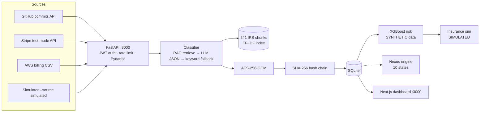

# TaxShield Enterprise

**Turn the telemetry software companies already produce — GitHub commits, cloud
bills, Stripe payments — into a defensible R&D tax credit claim and a multi-state
nexus watch, with every number traceable to an encrypted, tamper-evident ledger.**

Mid-market digital firms (10–250 employees, multi-state, on AWS/GitHub/Stripe)
routinely leave $50k+/year of IRS Section 41 R&D credits unclaimed because the
evidence lives in engineering systems that tax processes never read. TaxShield
ingests that operational telemetry, classifies expenses against official IRS
Section 41 guidance, encrypts and chains every event, and shows sales-tax nexus
risk on the same screen.

> **This is a student demonstration project (INTELLICON '26, Team Qubrix).**
> Estimates are simplified and are **not tax advice**. Insurance binders are
> **simulated**. The audit-risk model is **trained on synthetic data**. Nothing
> here should be filed with any tax authority without a licensed CPA's review.


## What is real, partial, and mocked

| Component | Status | Evidence |
|---|---|---|
| GitHub connector | **Real** (code-complete) | Calls the live GitHub REST API; needs your free read-only PAT in `.env` |
| Stripe connector | **Real, test mode** | Live Stripe API with `sk_test_` keys; refuses live keys by design |
| AWS billing | **CSV import, not a live API** | Upload endpoint + 28-row realistic sample; Cost Explorer costs money per call |
| R&D classifier | **Real, measured** | RAG over official IRS text; **97.9% accuracy** on 48 hand-labeled events (keyword engine). LLM engine activates with a free-tier key |
| IRS knowledge base | **Real** | 241 chunks from the IRS Form 6765 instructions PDF + Section 41 Audit Technique Guide pages, with source URLs |
| Nexus calculator | **Simplified, 10 states** | Thresholds researched from official state revenue sites; 6 verified, 4 marked "unverified" |
| Audit-risk model | **Trained on SYNTHETIC data** | XGBoost on 4,000 generated companies; holdout AUC 0.886. For demonstration only |
| Insurance binder | **SIMULATED** | No underwriter, no real coverage; transparent premium formula |
| Encryption | **Real** | AES-256-GCM, fresh nonce per record, key from environment only |
| Hash-chain ledger | **Real** | SHA-256 chain; tamper demo names the exact broken record (tested) |
| API auth | **Real** | JWT (HS256), rate limiting, CORS allowlist, Pydantic validation |
| Dashboard | **Real** | Next.js; all screens read live data from the API |
| Nitro Enclaves / mTLS PKI / LayoutLM / 11k jurisdictions / real underwriter | **Not built** | Roadmap only — see Limitations |

## Features

- **Ingest** events from GitHub commits, Stripe test-mode payments, and AWS
  billing CSVs — or the built-in simulator for offline demos (`--source simulated|live`).
- **Classify** each event against IRS Section 41: retrieve the most relevant
  official rule chunks (TF-IDF over 241 IRS chunks), ask the LLM for a strict
  JSON verdict, parse safely, fall back to explainable keyword rules on any
  failure. Every result names its engine, so you always know which path made
  the call. Results are cached — repeat demos never re-hit an API.
- **Encrypt & chain**: AES-256-GCM per event, then a SHA-256 hash chain.
  Tamper with one stored row and verification reports `first_broken_seq`.
- **Nexus watch** across CA, NY, TX, WA, FL, IL, MA, CO, GA, NC with
  thresholds and rates sourced from each state's revenue department (URLs in
  [data/nexus_states.json](data/nexus_states.json)), exposure estimates, and
  honest "unverified" flags where a state's site couldn't be read.
- **Audit-risk score** (XGBoost, synthetic training data — labelled everywhere)
  and a **simulated** parametric insurance binder with a transparent premium
  formula.
- **Dashboard**: login, overview, events feed with filters, nexus table, risk &
  insurance, ledger verification with a one-click tamper demo.

## Measured accuracy

We hand-labeled 48 events (qualified / not qualified) against the IRS
four-part test ([data/eval_labels.json](data/eval_labels.json), each with a
rationale) and ran the real classification pipeline over them
(`python -m ml.eval`):

| Engine | Accuracy | Precision | Recall | F1 |
|---|---|---|---|---|
| keyword-rules (fallback, no API key) | **0.979** | 0.957 | 1.000 | 0.978 |
| llm-rag | not measured | — | — | — (needs an LLM key; harness included) |

The one misclassification: an AWS "Bedrock model invocation" event was flagged
qualified on the word *model*, though the label treats consuming a hosted model
as routine. Honest numbers, reported as measured on our own labels — the eval
harness (`ml/eval.py`) prints every miss.

## Tech stack

| Layer | Choice | Why |
|---|---|---|
| API | FastAPI + uvicorn | Standard, fast, typed |
| Storage | SQLite (migratable to Postgres) | Zero-setup locally; schema keeps Gate 2 compatibility |
| Crypto | cryptography (AES-256-GCM) | Authenticated encryption, standard library |
| Auth | PyJWT + slowapi | HS256 tokens, per-route rate limits |
| Retrieval | TF-IDF over 241 IRS chunks | Free, offline, deterministic; no embedding API needed for a 241-doc corpus |
| LLM | Gemini / Groq / OpenAI / Ollama (any free tier) | Model-agnostic client; keyword fallback keeps the demo alive with no key |
| Risk model | XGBoost + scikit-learn | Interpretable, tiny, fast on CPU |
| Dashboard | Next.js 15 + Tailwind | Five screens, polling, loading/error states |

## Setup (verified from a clean clone on Windows; macOS/Linux equivalent)

```bash
git clone https://github.com/Thiviru-Opallage/taxshield-enterprise
cd taxshield-enterprise

# 1. Python backend
python -m venv venv
venv/Scripts/pip install -r requirements.txt      # macOS/Linux: venv/bin/pip

# 2. Configure secrets (never commit .env)
cp .env.example .env
#    edit .env: set TAXSHIELD_KEY (64 hex chars) and JWT_SECRET at minimum:
python -c "import secrets; print(secrets.token_hex(32))"

# 3. Seed the demo database and start everything
python run.py            # seeds 60 deterministic events, starts API on :8000

# 4. Dashboard (second terminal)
cd dashboard/web
npm install
npm run dev              # http://localhost:3000
```

Log in with `demo@taxshield.local` / `demo1234` (or whatever `DEMO_USER` /
`DEMO_PASSWORD` you set in `.env`).

**Optional live connectors** (each is genuinely optional — the simulator covers
demos without them):

- `GITHUB_TOKEN` (read-only PAT) + `GITHUB_REPO=owner/repo` → `POST /ingest/github`
- `STRIPE_TEST_KEY` (`sk_test_...`) → `POST /ingest/stripe`
- Any LLM free-tier key (`GEMINI_API_KEY` or `GROQ_API_KEY`) → classifier
  switches to the `llm-rag` engine automatically.
- AWS: upload `data/aws_billing_sample.csv` via the dashboard or
  `POST /ingest/aws-csv`. **This is a CSV import, not a live API.**

## Running the tests and checks

```bash
pytest -q                     # 21 tests: crypto, chain tamper, auth, validation, nexus, CSV
python -m ml.eval             # accuracy harness over the 48 labeled events
python -m security.tamper_demo   # break the ledger on purpose, watch verification catch it
python -m pip_audit -r requirements.txt   # dependency scan (clean as of 2026-10-11)
```

CI runs the same pytest suite on every push ([.github/workflows/ci.yml](.github/workflows/ci.yml)).

## Architecture



## Security

See [docs/SECURITY.md](docs/SECURITY.md) for the full threat model. In short:
payloads are AES-256-GCM encrypted, every record is hash-chained, all data
routes require a JWT, and the tamper demo proves detection works. What is
**not** protected, stated plainly: single non-rotating symmetric key, no
enclaves, no mTLS, chain proves tampering but cannot prevent a full-rewrite
attack by a key-holder.

## Limitations (deliberate scope cuts)

- **Simplified credit math**: flat 14% rate and $75/hr dev cost. Real §41 is
  incremental (fixed-base percentage, 50% floor) and subject to caps/AMT rules.
- **Nexus is 10 states, state-rate only**: ignores product taxability,
  exemptions, local rates, marketplace-facilitator duties, and
  physical-presence nexus. Four states are marked *unverified* because their
  revenue sites couldn't be read during research.
- **Risk model & insurance are demonstrative**: synthetic training data,
  simulated binder. No underwriter exists; no coverage is provided.
- **AWS is CSV import only** — no live Cost Explorer integration.
- **No Nitro Enclaves, no mTLS PKI, no LayoutLM invoice parsing, no 11,000
  jurisdictions** — these are roadmap items from the Gate 1 vision and are not
  implemented.
- **No deployment**: the deliverable is a clean one-command local run; hosting
  is roadmap.

## Roadmap

1. Postgres + deployment (Render/Fly free tier) with a public dashboard.
2. sentence-transformers embeddings + Qdrant local mode to replace TF-IDF.
3. Measured LLM-engine accuracy on the same 48-event eval set (harness ready).
4. Verify the four unverified state thresholds from their official sites.
5. Timesheet integration to replace the $75/hr hours assumption.
6. Per-record data keys wrapped by a KMS-managed master key; key rotation.
7. Nitro Enclaves for classification in a sealed environment; mTLS between services.
8. LayoutLM-based invoice/document extraction; more jurisdictions; a real
   underwriting partner (requires licensing).

## Team & course context

Team Qubrix — INTELLICON '26 Buildathon).
Roles: AI/ML, Cyber-Security, IoT & Cloud. Built with AI assistance; see
[docs/AI_USAGE.md](docs/AI_USAGE.md) for exactly what AI did and what the team
verified by hand. Business case: [docs/BUSINESS_CASE.md](docs/BUSINESS_CASE.md).

## License & data honesty

All data in this repository is simulated, test-mode, or synthetic. No real
personal or financial data is stored, processed, or transmitted. IRS and state
documents referenced are public-domain US government works.
